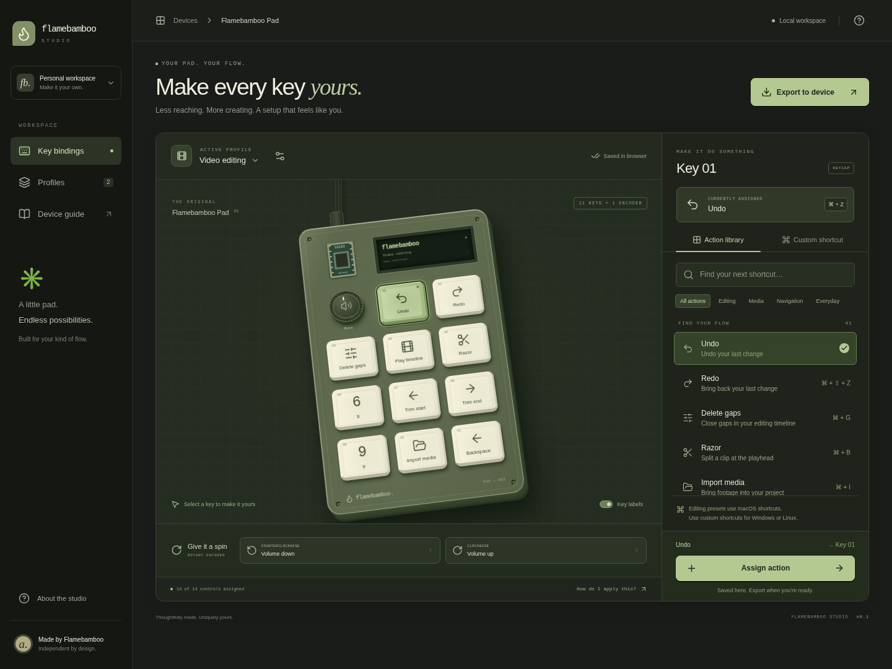

# Flamebamboo Studio

A browser app for making the Flamebamboo Pad your own. The interface uses the sage (`#819067`), warm cream (`#FEFAE0`), and khaki (`#B1AB86`) colors from [Asyraf’s portfolio](https://www.athmarasyraf.xyz/), with a device-centered interaction inspired by the supplied Logitech reference. The device is drawn in CSS from the repository’s CAD layout; it stays interactive at every screen size.



## Open locally in VS Code

Use Node.js **24 LTS** and npm. There is no backend, account, API key, or environment file to configure.

1. Open the repository folder in VS Code. If you received the source ZIP, extract it first and open the extracted `flamebamboo-pad` folder.
2. Open **Terminal → New Terminal** and run:

   ```bash
   cd web
   npm ci
   npm run dev
   ```

3. Open the local address printed by Vite in your browser. Keep that terminal running; edits in `src/` update the app automatically.

If you use nvm, run `nvm use` from this directory first. The `.nvmrc` selects Node 24. Use the same browser and local address to return to your saved profiles, since browser storage is specific to that address.

## What works

- Select all 11 physical keys, the encoder push, and clockwise/counterclockwise rotation.
- Search and filter 41 editing, media, navigation, and everyday actions.
- Build or record custom keyboard shortcuts, including modifiers and function keys.
- Assign the selected action explicitly; pending edits are marked and must be assigned before firmware export.
- Create profiles from the original video-editing layout, an everyday layout, or a blank canvas.
- Switch, rename, duplicate, and delete profiles; the last profile is protected from deletion.
- Persist profiles in browser storage and import/export versioned JSON backups.
- Recover the original raw data if saved browser profiles become unreadable. A recovery copy is retained before subsequent writes.
- Preview and download complete CircuitPython firmware as `code.py`.
- Use responsive layouts, keyboard navigation, visible focus, reduced-motion support, and accessible dialogs.

The editing presets match the repository’s original **macOS/Command** shortcuts. For Windows or Linux, use the custom shortcut editor to choose Control or other modifiers. Commands such as Razor and Trim are application-specific and depend on the shortcuts configured in your editor. A profile is a set of bindings; it does not automatically switch when your active application changes.

Profiles are saved only in this browser, with no cloud sync. Export a JSON backup before clearing browsing data. The device view is an editing preview: physical keycaps do not display labels, and the generated firmware retains the original OLED text.

## Put a profile on your pad

1. Connect your XIAO RP2040 with a USB data cable. It must already have a working CircuitPython/KMK installation and the display dependencies used by `Firmware/Main.py`.
2. Back up its existing startup file and any other important board files to your computer.
3. In the app, choose **Export to device → Download code.py**.
4. Copy the downloaded `code.py` to the root of the `CIRCUITPY` drive, replacing the startup file after making your backup. Keep the existing `kmk` and `lib` folders. CircuitPython normally reloads automatically.
5. Verify the keys, encoder, display, and chosen shortcuts on the physical pad. If the board does not reload, check its CircuitPython serial console for a firmware error and restore your backup if needed.

This version generates a file; it does **not** flash CircuitPython or communicate with the device over Web Serial/WebHID. The repository’s firmware has no configuration command protocol. Live updates would require coordinated firmware work and hardware validation.

The 4×3 matrix has 12 positions: encoder push at index 0, then 11 keys. Rotation uses the two separately editable encoder directions. Generated firmware preserves the existing pin definitions, COL2ROW matrix orientation, scan settings, encoder pins, OLED setup, and KMK extensions. Imports accept only supported key codes and never execute imported code. The export is checked as Python and against the existing hardware configuration, but actual RP2040 behavior has not been validated in the cloud.

## Build and tests

```bash
npm run build
npm run preview
```

`dist/` contains the static production site. Deploy it at the site root on any static host; no server-side application is required. `npm run preview` serves the build locally for inspection.

The model tests require Python 3.10+ on the command line as well as Node. On Windows, `python` is used by default; on other platforms, `python3` is used. Set `PYTHON_EXECUTABLE` if your interpreter has a different path.

```bash
npm test
npx playwright install chromium
npm run test:e2e
```

The browser tests start and stop their own Vite server on port 5173; stop any other application on that port first. They exercise assignment persistence, custom shortcuts, profiles, import validation, firmware downloads, recovery behavior, and mobile layout. They do not require a connected macropad.

In the prepared cloud environment, use its existing Chromium instead of downloading a browser:

```bash
export npm_config_cache=/workspace/.cache/npm
PLAYWRIGHT_CHROMIUM_EXECUTABLE_PATH=/usr/bin/chromium npm run test:e2e
```

## Source guide

| File                     | Purpose                                                                              |
| ------------------------ | ------------------------------------------------------------------------------------ |
| `src/App.tsx`            | Device view, action editor, profiles, browser storage, and export dialogs            |
| `src/styles.css`         | Brand palette, device illustration, responsive layouts, and component styling        |
| `src/lib/bindings.ts`    | Typed profile format, action catalog, validation, shortcuts, and firmware generation |
| `tests/bindings.test.ts` | Profile validation, firmware syntax, and hardware-configuration preservation         |
| `tests/app.spec.ts`      | Real-browser user workflows and layout checks                                        |

No runtime fonts, images, or analytics are fetched from third parties. The application uses native system fonts and bundled Lucide icons.
